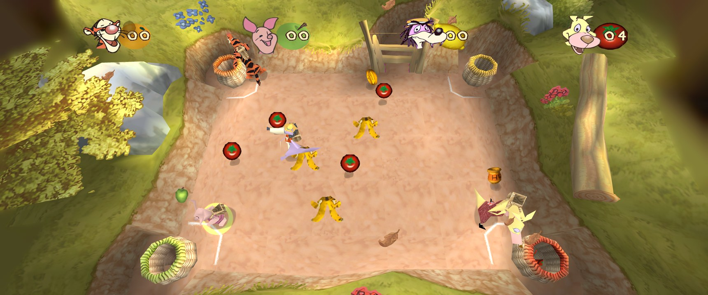
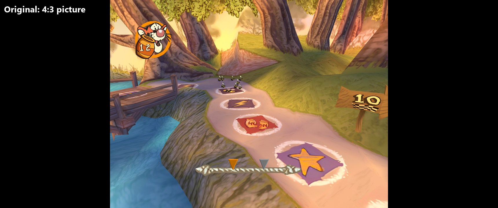
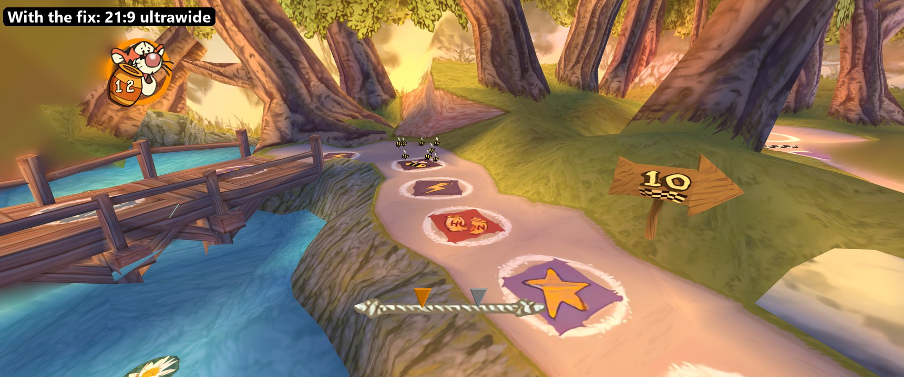
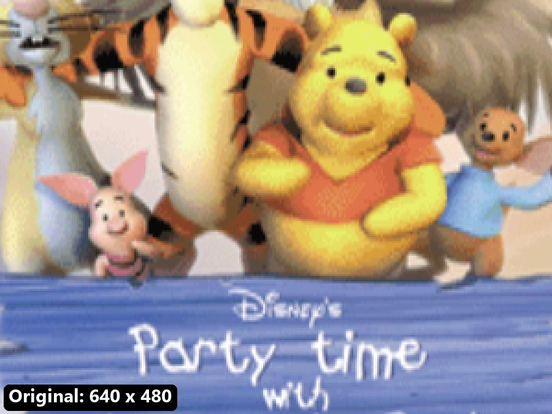
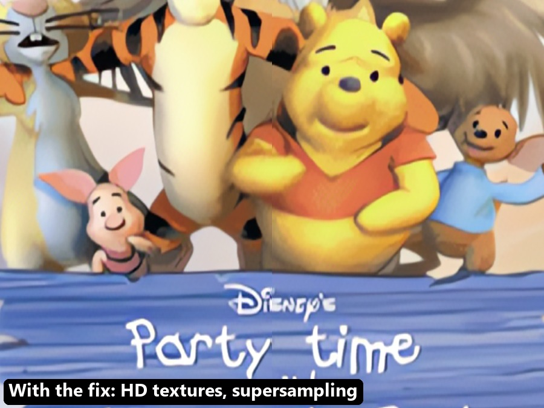

# Party Time with Winnie the Pooh PC

**Unofficial fix and setup:** play your own copy of **Disney's Party Time with Winnie the Pooh** (PC, 2002) on
Windows 10 and 11, the way a game should run today.

[-2ea44f?style=for-the-badge&logo=windows&logoColor=white)](https://github.com/kayliox/Party-Time-with-Winnie-the-Pooh-PC/releases/latest/download/PartyTimePooh-PCFix-Setup.exe)

You need your own game CD ([which one?](#what-you-need)). Then: download, run, play ([3 steps](#install-it-3-steps)).
All versions: [Releases](https://github.com/kayliox/Party-Time-with-Winnie-the-Pooh-PC/releases).

*Made with the help of AI. Without AI, this project would not have been possible ([more](#made-with-ai)).*

- **Widescreen and ultrawide** (16:9, 21:9, 32:9): the 3D boards fill the whole screen, menus stay in proportion.
- **Smooth 120 fps** with the game's speed unchanged (the original runs at 30).
- **Sharper picture**: 2x supersampling (smooth edges), anisotropic filtering, crisp text.
- **Settings inside the game**: press **F1** (or Back + Start on a gamepad).
- **Autosave**: the original only saves from the pause menu; the fix also saves your progress by itself and when you
  close the game.
- **No CD needed** after setup, no admin rights, nothing written to the Windows registry.

> This is a fan project. It does **not** include the game and is not made or supported by Disney or the original
> developers. You need your own copy (see below).

## See the difference

**Ultrawide:** the same moment on the first board. The original shows a 4:3 picture; with the fix the board fills a
21:9 screen and the score panel moves to the corner.

**Sharper picture:** a detail of the title screen at the same size. Left: the game at its original 640 x 480.
Right: with the fix (screen resolution, 2x supersampling and an HD texture pack).

| Original (640 x 480) | With the fix |
|---|---|
|  |  |

The higher resolution, supersampling and filtering come with the fix. The HD textures do not: the pack is made from
the game's own artwork, so you make it yourself from your copy ([how](docs/HD-TEXTURES.md)). The screenshots above
use such a pack.

## What you need

1. **Your own original CD of the game:** *Disney's Party Time with Winnie the Pooh* for Windows, **UK English
   edition** (CD-ROM, Disney Interactive, 2002). A disc image you made from your CD (**.iso** or **.bin**) works too.
   - How to recognise it: the CD has a folder called `Datas` and a folder `setup\Game` with the file `WTP.exe` in it.
   - The setup checks the exact version for you. Other editions (other languages or countries) have not been tested:
     the setup tells you if yours is different and lets you try anyway. Please report how it went (see
     [Help](#help)).
   - The game cannot be downloaded here, and copies of the game from the internet are not supported.
2. **Windows 10 or 11** and about **600 MB** of free disk space.
3. Any graphics card from the last 15 years.

## Install it (3 steps)

1. **Download** [`PartyTimePooh-PCFix-Setup.exe`](https://github.com/kayliox/Party-Time-with-Winnie-the-Pooh-PC/releases/latest/download/PartyTimePooh-PCFix-Setup.exe)
   (the green button at the top does the same).
2. **Put your game CD in the drive.** If you have a disc image instead, you can choose it in the setup (or double-click
   an .iso file to open it as a drive).
3. **Run the setup.** It finds your disc, checks it and shows where the game will go (normally
   `Games\Party Time with Winnie the Pooh` in your user folder). Click **Install**, wait about a minute, then click
   **Play**.

Windows may show *"Windows protected your PC"*, because the setup is not signed by a company. Click **More info**, then
**Run anyway**. The setup's source code is in this repository.

## Playing

- Start the game with the **shortcut** on the desktop or in the Start menu (or `WTP.exe` in the game folder). You do
  not need the old launcher (`Launcher.exe`).
- **Keyboard**, player 1: arrow keys to move, **O** and **P** as the two action buttons (O confirms), **Enter** also
  confirms. Player 2: **R F D G** to move, **Q** and **A**. Gamepads work too.
- **Settings:** press **F1** in the game (or Back + Start on a gamepad). Everything is saved as you change it.

  | Tab | What you can change |
  |---|---|
  | Display | Borderless fullscreen, exclusive fullscreen or a window; resolution; frame rate limit (120 = the game's own speed) |
  | Graphics | Supersampling, anisotropic filtering, ultrawide side fill, position of the score panels on wide screens |
  | Textures | HD textures on or off (only if you made a pack), smooth text |
  | Game | Autosave on or off, **Save now**, sound status |
  | Info | Frame rate and resolution details |

- **Saving:** the game saves your profile from *Adventure > Pause > Save game*, and the fix's autosave saves it a
  moment after your progress changes and when you close the game (Alt+F4 too). Your save is `DPTWP.sav` in the game
  folder; copy it somewhere to back it up.

## Updating and removing

- **Update:** download the newer setup, run it and choose the same folder. The button then says **Update fix**: it
  replaces only the fix and keeps your saves and settings. The CD is not needed for an update.
- **Remove:** delete the game folder and the two shortcuts. That is all.

## Help

| Problem | What to do |
|---|---|
| No sound | Open the Windows volume mixer and check that the game is not muted. The F1 overlay, Game tab, shows it and has an Unmute button. |
| The setup says "This is not the ... disc" | Check that the CD is in the drive (or choose the disc image). The CD must be the PC game CD with `Datas` and `setup\Game\WTP.exe`. |
| The setup says "different version" | Your copy is not the tested UK edition. You can install anyway; some fixes may switch themselves off. Please report it. |
| My antivirus warns about `d3d8.dll` | The fix works by placing this file next to the game, a common technique for game fixes. You can check its source code here. |
| The game does not start or crashes | Open an issue and attach `spartacompat.log` and `spartacompat.prev.log` from the game folder. |
| The picture is stretched or too small | F1 > Display > Aspect: "Ultrawide (hor+)" is the default; "4:3 with black bars" shows the original picture. |
| Movies look blurry | The game's movies are small 320 x 240 videos from 2002; they are scaled up to the screen. |

To report a problem or your results with another edition, open an issue in this repository. Include
`fix-install.log` (written by the setup) and the two `spartacompat` logs from the game folder.

## More

- [How it works](docs/HOW-IT-WORKS.md): what the fix changes and what it does not.
- [HD textures](docs/HD-TEXTURES.md): make your own HD texture pack from your copy (advanced).
- [Saves, unlocks and the hidden cheat](docs/SAVES-AND-UNLOCKS.md)
- [Settings file reference](docs/SETTINGS.md)
- [Known issues](docs/KNOWN-ISSUES.md)
- [Building from source](docs/BUILDING.md) (for developers)

## Made with AI

This project was made with the help of AI. The study of the 2002 game, the compatibility layer, the setup program,
the tests and these documents were developed together with Claude, an AI model made by Anthropic, step by step and
tested on a real copy of the game. Without AI, this project would not have been possible.

## Legal

*Disney's Party Time with Winnie the Pooh* and its characters belong to Disney. This project is not affiliated with,
endorsed by or connected to Disney, Doki Denki or any other company. It contains no game files: the setup copies the
game from your own disc on your own computer.

The fix (the compatibility layer, the setup program and their settings) is released under the [MIT License](LICENSE).
It uses [Dear ImGui](https://github.com/ocornut/imgui) (MIT License) for the settings overlay; see
[THIRD_PARTY_NOTICES.md](THIRD_PARTY_NOTICES.md).
